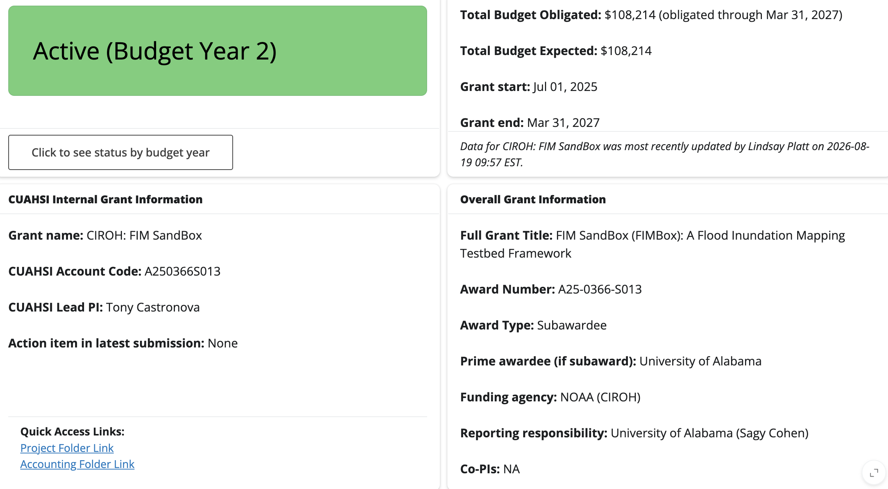

# CUAHSI AI Scaffolding

Agent skills for setting up CUAHSI software projects for AI-assisted engineering. The skills work with any agent that supports the [Agent Skills](https://skills.sh/) format, such as Claude Code, Zed, Cursor, and Codex. They set up CUAHSI's standard workflow: code and pull requests live on GitHub, and issues are tracked in Jira (project `CAM` on `cuahsi.atlassian.net`).

## Skills

| Skill | Summary |
| --- | --- |
| [`cuahsi-project-setup`](cuahsi-project-setup/SKILL.md) | One-time setup of a repo for the engineering skills, following CUAHSI project guidelines: GitHub for code and PRs, Jira for issues. It first checks that `gh`, `acli`, the Jira `netrc` credentials, and `setup-matt-pocock-skills` are ready. It then collects the project's Jira Objective, project labels, and base branch, runs `setup-matt-pocock-skills` with Jira as the issue tracker, and adds a PR template that links each PR to its Story. You must invoke it by name, since the agent won't trigger it automatically. |
| [`cuahsi-project-management`](cuahsi-project-management/SKILL.md) | Explicitly user-invoked kickoff, Project Charter drafting/revision, and private central-repository publication. Keeps charters on `main`, proposals on `develop`, and append-only decision logs adjacent to approved charters; requires verified staff-only access and leaves team review and approval to GitHub PRs outside the skill. |
| [`project-report`](project-report/SKILL.md) | Manually invoked, read-only historical Jira reporting for an explicit Research Project, Objective, or Epic, or a label selecting all matching Research Projects, and an inclusive date range. Produces cited Markdown under `reports/` and displays it in chat; accepts a timezone, people filter, format, and destination override. |

### Supporting assets

- [`cuahsi-project-setup/assets/issue-tracking-guidelines.md`](cuahsi-project-setup/assets/issue-tracking-guidelines.md) is the template for the Jira playbook that agents follow. Setup fills in its `{{...}}` placeholders (Objective, project labels, base branch, GitHub repo) and writes the result to `docs/agents/issue-tracker.md`. It covers the work-item hierarchy (Research Project → Objective → Epic → Story → Sub-task), `acli` commands, Jira REST calls for sprints and dates, branch, commit, and PR conventions, and wayfinding operations.
- [`cuahsi-project-setup/assets/pull_request_template.md`](cuahsi-project-setup/assets/pull_request_template.md) is copied to `.github/pull_request_template.md`. It asks for the Jira Story link, a summary, testing notes, and a short checklist.

## Prerequisites

Install and configure the following before running `cuahsi-project-setup`.

| Tool | Used for |
| --- | --- |
| [Node.js](https://nodejs.org/) (includes `npx`) | Installing skills with the [`skills`](https://skills.sh/) CLI |
| [Git](https://git-scm.com/) | Source control |
| [GitHub CLI (`gh`)](https://cli.github.com/) | Branches and pull requests |
| [Atlassian CLI (`acli`)](https://developer.atlassian.com/cloud/acli/) | Creating, reading, and updating Jira work items |
| `curl` + `~/.jira/netrc` | Jira REST calls that `acli` can't make (sprints, start dates, due dates, links, complete report evidence) |
| Python 3.9+ with IANA timezone data | Read-only `project-report` evidence collector (calendar-day boundaries and paginated Jira history); use the skill's manual GET-only retrieval path if unavailable |
| [`mattpocock/skills`](https://github.com/mattpocock/skills) | Provides `setup-matt-pocock-skills` and the engineering skills that `cuahsi-project-setup` configures |

### 1. Node.js and Git

macOS (with [Homebrew](https://brew.sh/)):

```sh
brew install node git
```

Linux and Windows: install Node.js LTS from <https://nodejs.org/> and Git from <https://git-scm.com/downloads>.

Verify:

```sh
node --version && npx --version && git --version
```

### 2. GitHub CLI (`gh`)

```sh
# macOS
brew install gh

# Windows
winget install --id GitHub.cli
```

On Linux, follow the [official install instructions](https://github.com/cli/cli/blob/trunk/docs/install_linux.md). Then sign in:

```sh
gh auth login
gh auth status
```

### 3. Atlassian CLI (`acli`)

```sh
# macOS
brew tap atlassian/homebrew-acli
brew install acli
acli --version
```

On Linux and Windows, follow Atlassian's [install guides](https://developer.atlassian.com/cloud/acli/guides/install-acli/). Atlassian supports each `acli` version for only 6 months, so keep it up to date.

Sign in to the CUAHSI Jira site. The browser option is simplest:

```sh
acli jira auth login --web
```

Or sign in with an API token (see step 4) read from a file, so the token stays out of your shell history:

```sh
acli jira auth login --site "cuahsi.atlassian.net" --email "<you>@cuahsi.org" --token < token.txt
```

Check that it worked with `acli jira auth status`.

> Tip: `acli` output opens in a pager. Run `export PAGER=cat` in non-interactive shells and agent sessions.

### 4. Jira REST credentials (`~/.jira/netrc`)

Some Jira operations need the REST API, which reads credentials from a private netrc file. Agents are told never to read or print this file.

1. Create a **classic** API token at <https://id.atlassian.com/manage-profile/security/api-tokens>. Choose **Create API token**, not **Create API token with scopes**.
2. Create the file with permissions that only you can read:

   ```sh
   mkdir -p ~/.jira && chmod 700 ~/.jira
   touch ~/.jira/netrc && chmod 600 ~/.jira/netrc
   open -e ~/.jira/netrc   # or: nano ~/.jira/netrc
   ```

3. Add the following, using your Atlassian email and token, and end the file with a newline:

   ```text
   machine cuahsi.atlassian.net
     login <atlassian-email>
     password <api-token>
   ```

4. Verify (read-only):

   ```sh
   ls -l ~/.jira/netrc   # must start with -rw-------
   curl -sS --netrc-file ~/.jira/netrc https://cuahsi.atlassian.net/rest/api/3/myself
   ```

   A JSON response with your `displayName` means it worked. HTTP 401 means the email, token, or `machine` host is wrong.

## Installing the skills

All skills are installed with the [`skills`](https://skills.sh/) CLI through `npx`, so you don't need a global install. By default, skills are installed in the current project. Add `-g` to install them for your user account across all projects, and `-a <agent>` to target a specific agent (for example `-a claude-code`).

### Install all skills from this repo

```sh
# See what's available
npx skills add CUAHSI/ai-scaffolding --list

# Install every skill for every detected agent, without prompts
npx skills add CUAHSI/ai-scaffolding --all

# Or install globally
npx skills add CUAHSI/ai-scaffolding --skill '*' -g
```

### Install the required `mattpocock/skills` dependency

`cuahsi-project-setup` follows `setup-matt-pocock-skills`, which comes from Matt Pocock's skill collection. It can read the installed skill directly if it is not available for automatic invocation:

```sh
npx skills add mattpocock/skills
```

### Install individual skills

```sh
npx skills add CUAHSI/ai-scaffolding --skill cuahsi-project-setup
npx skills add CUAHSI/ai-scaffolding --skill cuahsi-project-management
npx skills add CUAHSI/ai-scaffolding --skill project-report
```


### Manage installed skills

```sh
npx skills list          # project skills (add -g for global)
npx skills update        # update to latest versions
npx skills remove <name> # uninstall
```

## Usage

1. Install the prerequisites and skills above.
2. Open the repository you want to set up in your agent and invoke the setup skill by name, for example `/cuahsi-project-setup` in Claude Code.
3. When asked, give the Jira **Objective ID** for the project (for example `CAM-209`), then confirm the project labels and the base branch (`develop` if it exists, otherwise the default branch).
4. The skill writes configuration to `docs/agents/*.md` and adds `.github/pull_request_template.md`. You can edit those files directly later or re-run the skill to update the playbook from the latest template. Re-running shows a diff before changing anything.

Once setup is done, the engineering skills follow CUAHSI conventions:

- Stories and Epics are created under the project's Objective in Jira, with the project labels.
- Branches are named `<KEY>-<short-description>` and start from the base branch.
- Commit messages and PR titles start with the Jira key (for example `CAM-1500: Add HydroShare metadata collector`).
- Asking to `/implement` a Jira ticket assigns it to the requester, adds the Story to the active sprint, and moves it to `In Progress`.
- Asking to open a GitHub PR uses the repo's PR template, comments the PR link on the Story, and moves it to `In Review`.
- Reporting that a PR was reviewed or merged moves the Story to `Done` and adds a Jira comment, shown in chat. A review alone triggers this even if the PR has not been merged.
- These workflow actions need no separate approval; missing or ambiguous information and failed actions are reported.

### Project kickoff, charter revision, and publication

`cuahsi-project-management` ships in the top-level `cuahsi-project-management/` directory, alongside `cuahsi-project-setup`. It runs only when explicitly invoked (`disable-model-invocation: true`).

**Kickoff/revision prerequisites:** a compatible agent and the installed skill. Inputs can come from supplied documents and conversation; these local workflows need no GitHub, Jira, SharePoint, or email credentials, and do not require project setup or external provisioning.

```text
/cuahsi-project-management kickoff using the supplied proposal and our conversation; draft the charter in chat.
/cuahsi-project-management revise the supplied charter through an explicit Wayfinder session; preserve the original.
```

Changes to charter commitments require an explicit grilling or Wayfinder session, not silent updates from ordinary conversation; explicitly requested formatting and summary edits do not require another kickoff. The output is a roughly two-page Project Charter in chat using the full fixed [charter schema](cuahsi-project-management/assets/charter-template.md): a plain-language project summary first, then identity, purpose and research question, objectives as written and interpreted, deliverables with owners, dates, and rough sizes, key dates, team and roles, out of scope, risks and assumptions, and source documents. The header contains only `Date last modified: YYYY-MM-DD` beneath the title, with no AI-drafted, Reviewed by, Version, or Status fields, and no Sign-off section. Everything on `develop` is a proposal, so individual items need no `proposed` labels; specific unknowns still remain `pending`. Team review and approval happen outside the skill through GitHub PRs, which also carry revision history. Any optional work breakdown is separate from the charter. `kickoff` creates only `charter.md`, not `team-review.md` or a separate review/handoff document; questions and next steps stay in chat and the eventual PR description.

**Output and safety limits:** keep the charter in chat until the user chooses a private save destination or authorizes post-kickoff submission as described below. All live documents stay outside both the source checkout and the installed skill. Preserve source documents and baseline history; use a new file for a new save, or retain the baseline through Git history when an in-place revision is explicitly requested. Link budget and HR materials rather than copying their contents into the charter.

#### Example: FIMBox kickoff from attached materials

The FIMBox kickoff used two Word documents and a screenshot. Attach all three items in your agent:

| Attachment | What it provides |
| --- | --- |
| `Project Narrative FY25 Cohen FIMBox.docx` | Overall project objectives, collaborators, outputs, and original schedule. |
| `CUAHSI-Research-Plan-FIMBox.docx` | CUAHSI's subaward scope, contributions, and expected outputs. |
| Grant-information screenshot | Project identity, accounting code, lead PI, and award dates. |



*Screenshot supplied as a FIMBox kickoff input.*

Then use the same style of input as the original kickoff, with the local skill available:

```text
Use the ./cuahsi-project-management skill to kick off the FIMBox project.
Use the supplementary materials attached:
- Project Narrative FY25 Cohen FIMBox.docx
- CUAHSI-Research-Plan-FIMBox.docx
- Grant-information screenshot
```

With the skill installed, the equivalent invocation is:

```text
/cuahsi-project-management kickoff FIMBox using the two attached Word documents and grant-information screenshot.
```

The Word documents are attachments supplied in the conversation, not files bundled with this repository; the screenshot is reproduced above for reference. Preserve the distinction between the overall project narrative and CUAHSI's commitments, and link rather than transcribe financial details from the screenshot. The agent asks focused questions for missing information; kickoff does not automatically publish a charter.

#### Publish to the private central repository

All project charters and associated files are published to the fixed repository [CUAHSI/CUAHSI-ProjectStream](https://github.com/CUAHSI/CUAHSI-ProjectStream); the agent does not ask you to select a repository for each project. After `kickoff` delivers `charter.md`, simply reply **"this is approved"**. This authorizes the skill to save and commit the approved charter and necessary project navigation/mapping changes, push a focused topic branch to ProjectStream, and open a PR targeting **`develop`**, without another publish/push/PR request. Every change to ProjectStream, including later revisions, goes through a PR; the branch is named for the action, such as `kickoff-FIMBox-project-initiation` or `revise-FIMBox-simplify-charter-header`. The PR stays open for external team review; this does not authorize a direct push to `develop`, a merge, or promotion to `main`. Privacy/access and other publication prerequisites still apply, and ambiguous document sets or missing prerequisites are reported rather than guessed. See [Publish kickoff documents](cuahsi-project-management/SKILL.md#5-publish-kickoff-documents).

You can also request publication explicitly:

```text
/cuahsi-project-management publish this charter to develop only.
/cuahsi-project-management publish; prepare a focused promotion PR targeting main, leaving team review and approval to GitHub.
/cuahsi-project-management publish; plan only, no live writes.
```

**Publication prerequisites:** Git/GitHub CLI credentials for ProjectStream and an authorized private workspace, a canonical accounting code and confirmed case-preserving shortname, a named access administrator, Tony's tooling approval, and an authorized staff roster/access audit. The skill prepares requested publication PRs; team review and approval belong to the external GitHub PR process, not charter fields or a skill-managed sign-off gate. Repository privacy or organization membership alone does not prove staff-only access; failed/inaccessible checks remain explicit blockers, including for draft storage. Keep live charters and access evidence outside this source repository and installed skill.

Follow [Publication](cuahsi-project-management/assets/publication.md). The central layout is `projects/<accounting-code>-<shortname>/charter.md` with adjacent `decision-log.md` (for example, `projects/A250366S013-FIMBox/`). The accounting code remains canonical identity; confirm the human-readable shortname rather than infer it from the slug. Follow the publication guide's single-segment validation, reversible code-encoding record, and collision/duplicate checks. An explicitly requested path-only rename preserves charter/log bytes and Git history, updates navigation, and does not create a new project or revise commitments. Approved content lives on `main` through the external GitHub PR process; in-progress plans on `develop` are proposals by branch placement. Prepare a focused promotion PR for only the selected charter, never unrelated drafts by merging all of `develop`. Opening a PR does not authorize a merge. Initialize an empty log without inventing decisions; preserve existing entries, appending corrections through employee-reviewed decision PRs. Employees may self-merge decision PRs under repository policy. Link every related project/activity repository to the approved `blob/main` charter without copying restricted content.

The bundled [repository policy](cuahsi-project-management/assets/repository-policy-template.md) records owners, access/branch configuration, evidence, and per-repository links; the [decision PR template](cuahsi-project-management/assets/decision-pr-template.md) includes AI/review metadata and the withheld-items checkbox. A plan or open PR is not verified publication. Run [synthetic publication scenarios](cuahsi-project-management/assets/publication-scenarios.md) separately from live checks; reusable assets alone do not establish operational acceptance.

Automated transcript processing/decision extraction, scheduling, reports, exports, and a hosted site remain future Stories. The existing `project-report` skill remains unchanged, Jira-only, and read-only.

## Repository layout

```text
.
├── cuahsi-project-setup/
│   ├── SKILL.md
│   └── assets/
│       ├── issue-tracking-guidelines.md
│       └── pull_request_template.md
├── .gitignore
└── README.md
```

## Contributing

To add a skill, create a folder with a `SKILL.md` that has `name` and `description` front matter (`npx skills init <name>` creates one). Then check that the skill is found with `npx skills add . --list`.
